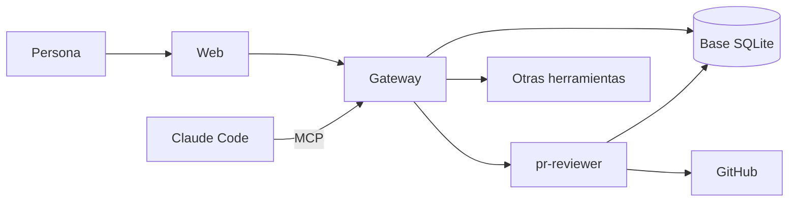

# Atalaya

**Herramientas de gestión de proyectos de software, sobre las plataformas que tu equipo ya usa.**

Atalaya se conecta a tu backlog y a tu repositorio, trae los datos tal cual están y agrega lo que Jira, Linear o GitHub no te dan: avisos sobre historias mal escritas, una probabilidad de cierre para el sprint, huecos de trazabilidad y revisiones de pull requests con contexto del proyecto. No es un gestor de tareas propio: lee y analiza lo que ya vive en tus herramientas.

> **Estado: en desarrollo temprano (Sprint 0).** Todavía no hay código ejecutable. Hoy el repositorio contiene la documentación del proyecto y las decisiones de arquitectura; el esqueleto del monorepo es lo próximo.

## Por qué existe

Los equipos chicos gestionan su trabajo en plataformas que no avisan si una historia está mal escrita, si el sprint va a cerrar, qué requerimientos quedaron sin pruebas o qué cambia una pull request en la arquitectura. Cada equipo termina armando vistas y scripts propios, atados a un solo proyecto y a un solo gestor de tareas. Atalaya busca ser esa capa reutilizable.

## Qué va a incluir

| Herramienta | Qué hace | Estado |
|---|---|---|
| **Revisor de pull requests** | Entrega a Claude el PR y el contexto del repositorio; guarda los hallazgos como borrador y los publica en GitHub solo tras una vista previa y tu confirmación | Primera herramienta, en diseño |
| Linter de user stories | Puntúa la calidad de las historias contra reglas configurables | Planeada |
| Forecast de sprint | Probabilidad de cerrar el sprint, por simulación de Monte Carlo | Planeada |
| Matriz de trazabilidad | Cruza requerimientos, commits y pruebas, y marca los huecos | Planeada |
| Visualizador de dependencias | Grafo de dependencias entre módulos, con ciclos y acoplamiento | Planeada |
| Mapa del sprint | Las historias del sprint como diagrama, con bloqueos y camino crítico | Planeada |

## Cómo está pensado

Un servicio por herramienta, cada uno en su carpeta, y un gateway que es el único punto de entrada.

- **Servicios aislados.** Cada herramienta tiene su proceso, su puerto, sus tablas y sus pruebas, y no importa código de otra.
- **Una sola base local.** Un archivo SQLite compartido, con tablas separadas por servicio.
- **IA a través de Claude, no por API.** Las revisiones las hace Claude desde tu propia sesión, conectándose a Atalaya por MCP. Atalaya no guarda claves de modelos ni llama a ninguno por su cuenta.
- **Todo local.** Los servicios escuchan solo en `127.0.0.1`.

## Principios

- **Nada se dispara solo.** Cada revisión o acción nace de un pedido explícito de la persona usuaria.
- **Nunca aprueba ni fusiona.** Como máximo publica comentarios, después de mostrar una vista previa y pedir confirmación.
- **Lo determinístico primero.** Lo que se resuelve con reglas o estadística se resuelve así; la IA es una capa opcional.
- **El contenido de un PR es dato no confiable.** Nunca se obedece como instrucción.
- **Datos locales y reproducibles.** Las pruebas no usan la red.

## Stack

TypeScript (modo estricto) en un monorepo de npm workspaces · Node 20+ · Fastify y zod · SQLite · React, Vite y Tailwind CSS · vitest · ESLint y Prettier.

## Documentación

- [Visión y no-objetivos](documents/documentacion-proyecto/documentos-pre-desarrollo/vision-y-no-objetivos.md)
- [Estudio inicial](documents/documentacion-proyecto/documentos-pre-desarrollo/estudio-inicial.md)
- [Alcances para una segunda etapa](documents/documentacion-proyecto/documentos-dinamicos/alcances-segunda-etapa.md)
- Decisiones de arquitectura:
  - [ADR-001 · Servicios por herramienta y gateway](documents/documentacion-proyecto/documentos-dinamicos/adr/ADR-001-servicios-por-herramienta-y-gateway.md)
  - [ADR-002 · Revisiones con IA vía MCP](documents/documentacion-proyecto/documentos-dinamicos/adr/ADR-002-revisiones-con-ia-via-mcp.md)
  - [ADR-003 · Base de datos única](documents/documentacion-proyecto/documentos-dinamicos/adr/ADR-003-base-de-datos-unica.md)

## Hoja de ruta

1. **Sprint 0:** repositorio, esqueleto del monorepo, integración continua y reglas de trabajo.
2. **Base de la plataforma:** acceso a la base de datos, plantilla de servicio, gateway y servidor MCP.
3. **Revisor de pull requests:** de punta a punta, con interfaz web.
4. **Después:** el resto de las herramientas, cada una como un servicio nuevo.

## Licencia

Sin definir todavía. Mientras tanto, todos los derechos están reservados.
