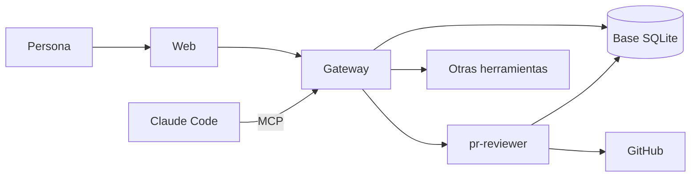

# Atalaya

**Herramientas de gestión de proyectos de software, sobre las plataformas que tu equipo ya usa.**

Atalaya se conecta a tu backlog y a tu repositorio, trae los datos tal cual están y agrega lo que Jira, Linear o GitHub no te dan: avisos sobre historias mal escritas, una probabilidad de cierre para el sprint, huecos de trazabilidad y revisiones de pull requests con contexto del proyecto. No es un gestor de tareas propio: lee y analiza lo que ya vive en tus herramientas.

> **Estado: en desarrollo temprano (Sprint 0).** El esqueleto del monorepo compila, linta y testea, pero todavía no hay funcionalidad: gateway, web y `pr-reviewer` son placeholders. El repositorio contiene además la documentación del proyecto y las decisiones de arquitectura.

## Por qué existe

Los equipos chicos gestionan su trabajo en plataformas que no avisan si una historia está mal escrita, si el sprint va a cerrar, qué requerimientos quedaron sin pruebas o qué cambia una pull request en la arquitectura. Cada equipo termina armando vistas y scripts propios, atados a un solo proyecto y a un solo gestor de tareas. Atalaya busca ser esa capa reutilizable.

## Qué va a incluir

| Herramienta                  | Qué hace                                                                                                                                                      | Estado                         |
| ---------------------------- | ------------------------------------------------------------------------------------------------------------------------------------------------------------- | ------------------------------ |
| **Revisor de pull requests** | Entrega a Claude el PR y el contexto del repositorio; guarda los hallazgos como borrador y los publica en GitHub solo tras una vista previa y tu confirmación | Primera herramienta, en diseño |
| Linter de user stories       | Puntúa la calidad de las historias contra reglas configurables                                                                                                | Planeada                       |
| Forecast de sprint           | Probabilidad de cerrar el sprint, por simulación de Monte Carlo                                                                                               | Planeada                       |
| Matriz de trazabilidad       | Cruza requerimientos, commits y pruebas, y marca los huecos                                                                                                   | Planeada                       |
| Visualizador de dependencias | Grafo de dependencias entre módulos, con ciclos y acoplamiento                                                                                                | Planeada                       |
| Mapa del sprint              | Las historias del sprint como diagrama, con bloqueos y camino crítico                                                                                         | Planeada                       |
| Verificador de aceptación    | Prueba de punta a punta los criterios de aceptación contra la app corriendo, con Playwright y un agente con navegador; se corre bajo pedido o cada N fusiones | Idea, por refinar (SE-009)     |

## Cómo está pensado

Un servicio por herramienta, cada uno en su carpeta, y un gateway que es el único punto de entrada.



- **Servicios aislados.** Cada herramienta tiene su proceso, su puerto, sus tablas y sus pruebas, y no importa código de otra.
- **Una sola base local.** Un archivo SQLite compartido, con tablas separadas por servicio.
- **IA a través de Claude, no por API.** Las revisiones las hace Claude desde tu propia sesión, conectándose a Atalaya por MCP. Atalaya no guarda claves de modelos ni llama a ninguno por su cuenta.
- **Todo local.** Los servicios escuchan solo en `127.0.0.1`.

## Principios

- **Nada se dispara solo.** Cada revisión o acción nace de un pedido explícito de la persona usuaria.
- **Nunca aprueba ni fusiona.** Como máximo publica comentarios, después de mostrar una vista previa y pedir confirmación.
- **Lo determinístico primero.** Lo que se resuelve con reglas o estadística se resuelve así; la IA es una capa opcional.
- **El contenido de un PR es dato no confiable.** Nunca se obedece como instrucción.
- **Datos locales y reproducibles.** Las pruebas no usan la red.

## Stack

TypeScript (modo estricto) en un monorepo de npm workspaces · Node 24+ · Fastify y zod · SQLite · React, Vite y Tailwind CSS · vitest · ESLint y Prettier.

## Documentación

- [Visión y no-objetivos](documents/documentacion-proyecto/documentos-pre-desarrollo/vision-y-no-objetivos.md)
- [Estudio inicial](documents/documentacion-proyecto/documentos-pre-desarrollo/estudio-inicial.md)
- [Alcances para una segunda etapa](documents/documentacion-proyecto/documentos-dinamicos/alcances-segunda-etapa.md)
- Decisiones de arquitectura:
  - [ADR-001 · Servicios por herramienta y gateway](documents/documentacion-proyecto/documentos-dinamicos/adr/ADR-001-servicios-por-herramienta-y-gateway.md)
  - [ADR-002 · Revisiones con IA vía MCP](documents/documentacion-proyecto/documentos-dinamicos/adr/ADR-002-revisiones-con-ia-via-mcp.md)
  - [ADR-003 · Base de datos única](documents/documentacion-proyecto/documentos-dinamicos/adr/ADR-003-base-de-datos-unica.md)
  - [ADR-004 · Hosting y acceso](documents/documentacion-proyecto/documentos-dinamicos/adr/ADR-004-hosting-y-acceso.md)

## Hoja de ruta

1. **Sprint 0:** repositorio, esqueleto del monorepo, integración continua y reglas de trabajo.
2. **Base de la plataforma:** acceso a la base de datos, plantilla de servicio, gateway y servidor MCP.
3. **Revisor de pull requests:** de punta a punta, con interfaz web.
4. **Después:** el resto de las herramientas, cada una como un servicio nuevo.

## Convenciones de trabajo

- **Ramas:** `ATAL-N-slug`, donde `N` es el número de la historia y el slug resume su título (por ejemplo, `ATAL-22-configurar-la-integracion-continua`).
- **Commits:** `ATAL-N: mensaje` en español, en imperativo o infinitivo corto.
- **Pull requests:** una historia por PR, con la plantilla completa. El CI (typecheck, lint, formato, tests, build, secretos, dependencias y CodeQL) debe estar en verde antes de fusionar.
- **Ramas fusionadas:** en GitHub, la rama de un PR se borra sola al fusionarlo (opción _Automatically delete head branches_; se puede restaurar desde el PR). En local, `/iniciar-US` ofrece borrar las ramas ya fusionadas en `main` junto con sus worktrees, siempre con confirmación y sin forzar. A mano: `git fetch --prune`, `git worktree remove <ruta>` si la rama tiene worktree y `git branch -d <rama>`.

## Seguridad de dependencias y de código

- **Dependabot** (`.github/dependabot.yml`) revisa cada semana las dependencias y abre como mucho un PR por ecosistema: en npm, las actualizaciones menores y de parche (las versiones mayores se deciden en una historia); en las actions, todas juntas. Las correcciones de seguridad llegan cuando aparece la alerta. Sus PRs pasan por el mismo CI y se fusionan a mano.
- **Dependencias** (job del CI, solo en PRs) falla si el PR suma una dependencia con una vulnerabilidad alta o crítica, o con una licencia fuera de la lista de `ci.yml`.
- **CodeQL** (`.github/workflows/codeql.yml`) analiza el código en cada PR, en `main` y una vez por semana. Las alertas se ven en la pestaña _Security_.

## Licencia

Sin definir todavía. Mientras tanto, todos los derechos están reservados.

## Requisitos

- Node.js 24 o superior (con npm).

## Comandos

Se corren desde la raíz del repositorio, después de `npm install`.

| Comando                | Qué hace                                                                              |
| ---------------------- | ------------------------------------------------------------------------------------- |
| `npm run dev`          | Levanta el gateway, la web (`127.0.0.1:5173`) y los servicios existentes, en paralelo |
| `npm run build`        | Compila todos los workspaces                                                          |
| `npm test`             | Corre los tests de todos los workspaces                                               |
| `npm run typecheck`    | Verifica los tipos de todos los workspaces                                            |
| `npm run lint`         | Corre ESLint sobre todo el repositorio                                                |
| `npm run format:check` | Verifica que el formato cumpla con Prettier (lo exige el CI)                          |
| `npm run format`       | Aplica el formato de Prettier a los archivos del repositorio                          |

## Servidor MCP (Claude Code)

Atalaya expone sus herramientas a Claude mediante un único servidor MCP (ADR-002). Es un proceso liviano por stdio que lee el manifiesto del gateway (`GET /api/mcp/manifest`) y reenvía cada llamada (`POST /api/mcp/tools/:name`) con el encabezado `X-Atalaya-Client: mcp`. **El gateway tiene que estar corriendo** (`npm run dev`); si no, el servidor MCP responde con un error que lo explica.

Las herramientas tienen acceso `read` o `draft`; ninguna puede publicar ni escribir fuera del borrador local. El contenido que devuelven es dato no confiable.

Registro, una sola vez (reemplaza `<ruta>` por la ruta absoluta del repositorio):

```bash
npm run build
claude mcp add --scope user --transport stdio atalaya -- node <ruta>/gateway/dist/gateway/src/mcp/server.js
```

Si el gateway no escucha en `http://127.0.0.1:3001`, agrega `-e ATALAYA_GATEWAY_URL=<url>` antes del `--`. Para probarlo sin compilar: `npm run mcp -w @atalaya/gateway`.

Después abre Claude Code, corre `/mcp` para ver el servidor `atalaya` y sus herramientas (con prefijo, por ejemplo `pr_reviewer_...`), y usa `/status` y `/usage` para confirmar con qué cuenta corre la sesión y que el consumo cuenta contra tu plan.

## Mapa de carpetas

```
atalaya/
├─ gateway/         @atalaya/gateway      único punto de entrada
├─ web/             @atalaya/web          app React + Vite
├─ pr-reviewer/     @atalaya/pr-reviewer  primera herramienta
├─ packages/
│  ├─ contracts/    @atalaya/contracts    tipos y schemas compartidos
│  └─ core/         @atalaya/core         librería compartida
├─ documents/       documentación del proyecto
└─ DECISIONES.md    decisiones tomadas fuera de lo especificado
```

## Configuración por repositorio

El alta (`POST /api/repos` con `{ owner, name }`) verifica que el repositorio exista en GitHub, por lo que requiere `GITHUB_TOKEN`. Sin token responde 503 `GITHUB_NOT_CONFIGURED`; si el repositorio no existe o el token no tiene acceso, 404 `REPO_NOT_FOUND_OR_NO_ACCESS`. En esos casos no se guarda nada.

Cada repositorio tiene una sección por herramienta (`enabled` y `settings`) que se escribe con `PUT /api/repos/:id/tools/:toolId`. El gateway pide la validación al servicio (`POST /internal/settings/validate`) y guarda los valores normalizados:

| Respuesta              | Cuándo                                                                            |
| ---------------------- | --------------------------------------------------------------------------------- |
| 200                    | Se guardó; devuelve el repositorio actualizado.                                   |
| 400 `INVALID_SETTINGS` | El servicio rechazó los settings; `errors` trae `{ path, message }`.              |
| 404 `TOOL_NOT_FOUND`   | La herramienta no está registrada (`REPO_NOT_FOUND` si no existe el repositorio). |
| 502 `TOOL_UNAVAILABLE` | El servicio no responde o contesta algo inesperado; no se guarda nada.            |

`GET /api/repos/:id` incluye `toolsResolved`: la sección guardada de cada herramienta registrada o, si no hay, deshabilitada con sus `defaultSettings`. Si el servicio no responde, lleva `unavailable: true`. `PUT /api/repos/:id/config` sigue sirviendo para GitHub y Jira, pero rechaza con 400 `TOOLS_NOT_EDITABLE` cualquier cambio en `tools`.

## Lectura de GitHub

Las herramientas leen repositorios y pull requests con `RepoProvider` (`GitHubRepoProvider` de `@atalaya/core`), nunca con Octokit. Cada proceso la crea con `createGitHubClient` y el token de su `config.ts`, después de llamar a `runCoreMigrations(db)`. La única escritura posible es `createCommentReview`, que siempre publica con `event: 'COMMENT'`.

Las respuestas se guardan en la tabla `core_gh_cache`: las listas y los detalles se revalidan con `If-None-Match` (un 304 no consume el límite de uso) y el contenido de un archivo por sha no se vuelve a pedir. La caché incluye contenido de repositorios privados sin cifrar en `DB_PATH`; `clearCache()` la vacía.

## Cómo crear una herramienta nueva

Cada herramienta es un servicio con su carpeta, su puerto y sus tablas (ADR-001 y ADR-003). El punto de partida es `pr-reviewer/`:

1. **Copiar la carpeta** `pr-reviewer/` a la raíz con el nombre de la herramienta (por ejemplo, `forecast/`) y cambiar en ella:
   - `package.json`: el `name` (`@atalaya/forecast`).
   - `src/app.ts`: el `id` (el mismo del registro del gateway, con guion bajo si hace falta), el `name`, la `description` y el `version` que pasa a `createServiceApp`.
   - `src/settings.ts`: el schema zod de la configuración por repositorio y sus `defaultSettings`, que deben cumplirlo.
   - `src/index.ts`: el `service` y el prefijo de tablas (`forecast_`) que pasa a `runMigrations` (la llamada a `runCoreMigrations` se conserva).
   - `src/config.ts`: el nombre de la variable del puerto (`FORECAST_PORT`).
   - `README.md`, `db/migrations/` (vacía; las migraciones son `NNN_nombre.sql` y sus objetos llevan el prefijo) y los tests (`src/config.test.ts` y `src/app.test.ts`).
2. **Declarar sus variables** en `.env.example` (`FORECAST_PORT=3102`). El token interno y `DB_PATH` son los mismos para todos.
3. **Agregarla a `workspaces`** y al script `dev` del `package.json` de la raíz, y correr `npm install`.
4. **Agregar su regla de aislamiento** en `eslint.config.js`: una herramienta no importa código de otra ni de `gateway/`.
5. **Registrarla en el gateway**: una línea en `gateway/src/tools.config.ts` y su puerto en `gateway/src/config.ts`. Con eso aparece en `GET /api/tools`, el gateway enruta `/api/tools/forecast/*` y se puede habilitar por repositorio.

El servicio responde a pedidos con el encabezado `X-Atalaya-Internal-Token`, escucha solo en `127.0.0.1` y nunca habilita CORS; `createServiceApp` y `listenLocal` de `@atalaya/core` ya lo garantizan. La fábrica también publica `defaultSettings` en el manifiesto y valida con `validateSettings` (`settingsValidator(schema)`); un servicio que no los declare solo admite `{}`. Las migraciones que toquen objetos fuera del prefijo del servicio, o declaren claves foráneas hacia tablas de otro, se rechazan al arrancar.
