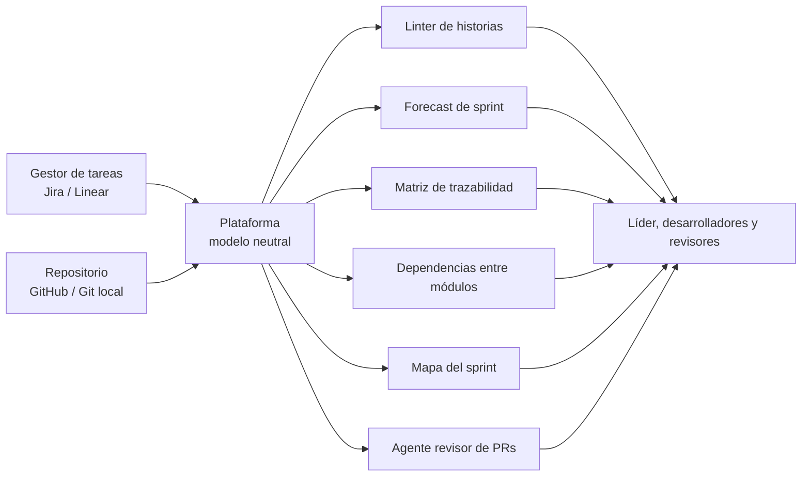

# Estudio inicial

Nov 6, 2026 · @Lucas · v0.1

*Para qué:* validar que se entiende el problema antes de comprometerse con una solución. *Para quién:* Lucas y una persona real que confirme el diagnóstico.

> **Estado:** borrador. Falta la validación con una persona real (sección 5); hasta completarla, el diagnóstico es una hipótesis.

## 1. Contexto y procesos actuales

**Cómo se gestiona hoy el trabajo de un equipo de software chico.**

1. El backlog vive en un gestor de tareas (Jira, Linear) con historias, estimaciones, responsables, estados y vínculos de bloqueo.
2. El código vive en un repositorio (GitHub) y cada cambio entra por una pull request revisada por otra persona.
3. Al planificar un sprint, el equipo elige historias y estima por intuición o por la velocidad de los últimos sprints.
4. Durante el sprint, quien gestiona mira el tablero para ver qué está bloqueado, qué falta estimar y quién está sobrecargado.
5. Al cerrar, se revisa qué se terminó y, en contextos académicos o de auditoría, se arma a mano la trazabilidad entre requerimientos, código y pruebas.

**Información que manejan:** issues (título, descripción, criterios de aceptación, puntos, responsable, estado), sprints, vínculos de bloqueo, commits, ramas, pull requests, árbol de archivos y archivos de prueba.

**Sistemas existentes:** Jira o Linear para tareas, GitHub para código, y planillas o scripts propios para lo que esos sistemas no muestran.

## 2. Alternativas existentes y por qué no alcanzan

Se revisaron herramientas existentes para cada una de las seis herramientas planeadas. La columna "por qué no alcanza" es una hipótesis a confirmar en la sección 5.

| Necesidad | Alternativa | Qué hace | Por qué no alcanza (hipótesis) |
|---|---|---|---|
| Forecast de sprint | ActionableAgile para Jira | Simulación de Monte Carlo sobre datos históricos, gráficos de tiempo de ciclo y trabajo envejecido, para Jira Cloud y Data Center. | Es una aplicación paga de Jira, cerrada y sin edición de escenarios sobre el sprint real. |
| Forecast de sprint | Swarmia | Monte Carlo sobre el esfuerzo pasado, con fechas al 50 %, 80 % y 90 %; trabaja sobre iniciativas o issues padre en curso y requiere historial reciente de esfuerzo. | Apunta a iniciativas y no al cierre de un sprint; es un servicio externo con costo. No verifiqué si soporta Jira. |
| Revisión de pull requests | CodeRabbit, Greptile, GitHub Copilot, entre otras | Revisan con IA de forma automática o a pedido; Greptile construye un grafo del código y Copilot explora el repositorio. | Son servicios pagos por usuario, suelen dispararse solos y no guardan un contexto editable por repositorio ni piden acceso repo por repo con acción manual. |
| Dependencias entre módulos | dependency-cruiser (y madge) | Valida reglas de dependencias prohibidas, ciclos y huérfanos en JavaScript y TypeScript, y exporta a Mermaid, HTML y otros formatos. | Cubre JavaScript y TypeScript pero no Python; no compara versiones ni se integra con la revisión de pull requests. |
| Trazabilidad | Aplicaciones de Jira para requerimientos y pruebas (Xray, Bestest, entre otras) | Vinculan requerimientos con casos de prueba dentro de Jira. | Trabajan sobre casos de prueba cargados en Jira, no cruzan commits y ramas del repositorio con archivos de prueba. |
| Linter de historias | No encontré una herramienta dedicada en la búsqueda inicial | — | Pendiente de verificar: puede no existir una opción equivalente. |
| Mapa del sprint | Tablero y gráficos nativos de Jira o Linear | Muestran estados, burndown y vínculos de bloqueo. | No dan un diagrama de dependencias por capas ni camino crítico. |
| Todas | Hacerlo a mano o con scripts propios | Planillas, consultas guardadas, vistas armadas por cada equipo. | Se rehace en cada proyecto y queda atado a un gestor y a un repositorio. |

**Lo que ninguna alternativa combina** (a validar): un modelo neutral que sirva a varios gestores de tareas, herramientas que lean y también editen con confirmación, y funcionamiento local sobre una caché de datos.

## 3. Mapa global de actores y procesos

| Actor | Qué hace en el entorno | Qué necesita de la plataforma |
|---|---|---|
| Líder técnico o PM | Planifica sprints, destraba bloqueos, reporta avance | Forecast, mapa del sprint, calidad del backlog |
| Desarrollador | Escribe historias y código, abre pull requests | Feedback sobre sus historias y sobre su pull request |
| Revisor de código | Revisa pull requests con poco contexto | Hallazgos con evidencia y contexto del repositorio |
| Estudiante o equipo académico | Entrega documentación y trazabilidad | Matriz de trazabilidad exportable |
| Quien evalúa o audita | Revisa proceso y calidad técnica | Evidencia de trazabilidad y de métricas |
| Administrador del gestor de tareas | Entrega tokens y permisos de acceso | Acceso mínimo y revocable |

## 4. Restricciones

| Tipo | Restricción |
|---|---|
| Tiempo | El MVP apunta al 31/12/2026. Calidad por encima de velocidad: ante un atraso se reestiman los tiempos, no se recorta alcance ni calidad. |
| Equipo | Una sola persona, que cumple todos los roles; la capacidad real por sprint se define en el Plan de proyecto. |
| Presupuesto | Sin presupuesto asignado. Los costos posibles (API del modelo de IA, hosting) se estiman en el Plan de proyecto y la IA es siempre opcional. |
| Legales | El backlog y el código pueden contener datos personales: aplica la Ley 25.326 de protección de datos personales. Hay que respetar los términos de uso de las APIs de Jira y GitHub, y el código solo se envía al modelo que el usuario configuró. |
| Técnicas | TypeScript en monorepo. Jira: búsquedas JQL con paginación por token, campo de puntos distinto en cada instancia y límites de uso de la API. Credenciales fuera del repositorio. Por defecto no se ejecuta el código de las pull requests. |
| Alcance | Análisis de código solo en TypeScript, JavaScript y Python; solo Jira en el MVP (ver Visión y no-objetivos). |

## 5. Diagnóstico y validación

**Diagnóstico a validar.** Los equipos chicos no tienen una forma reutilizable de ver la salud de su sprint, la calidad de su backlog, la trazabilidad de sus requerimientos y el impacto de sus pull requests: cada uno arma soluciones propias atadas a su gestor de tareas o paga herramientas separadas que no comparten datos.

**Hipótesis concretas:**

1. Quienes gestionan sprints deciden hoy el alcance por intuición y les serviría una probabilidad de cierre.
2. Las historias mal escritas son un problema frecuente y nadie las revisa de forma sistemática.
3. Armar la trazabilidad a mano consume tiempo y se hace tarde.
4. Quien revisa pull requests suele hacerlo con poco contexto del resto del sistema.

**Guía de preguntas para la entrevista:**

- ¿Cómo decidís qué entra en un sprint y cómo sabés si va a cerrar?
- ¿Qué mirás en el tablero cada día y qué te falta ver?
- ¿Cómo revisás una pull request y qué te cuesta más?
- ¿Alguna vez armaste una vista, planilla o script propio para suplir algo? ¿Cuál?
- ¿Qué herramientas pagás o probaste y por qué las dejaste?

**Registro de la validación (pendiente):**

| Campo | Valor |
|---|---|
| Persona y rol | Pendiente |
| Fecha | Pendiente |
| Hipótesis confirmadas | Pendiente |
| Hipótesis descartadas o ajustadas | Pendiente |
| Hallazgos nuevos | Pendiente |

## Fuentes

Consultadas el 06/11/2026; las funciones y precios de terceros pueden cambiar.

- [Swarmia, Forecast](https://help.swarmia.com/features/forecast)
- [ActionableAgile para Jira, Atlassian Marketplace](https://marketplace.atlassian.com/apps/1216661/actionableagile-for-jira-agile-metrics)
- [dependency-cruiser, GitHub](https://github.com/sverweij/dependency-cruiser)
- [GitHub AI Code Review: 6 Tools That Actually Work on PRs (2026), Morph](https://www.morphllm.com/github-ai-code-review) (comparativa de terceros, no documentación oficial)
